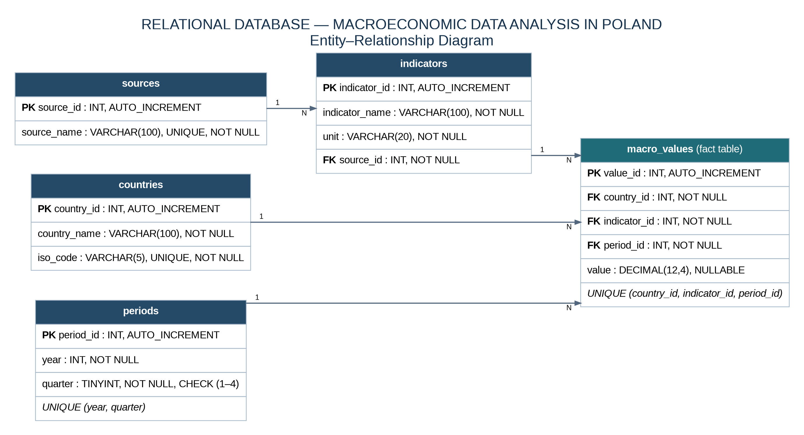

# Relational Database for Macroeconomic Data Analysis in Poland

A MySQL database project developed as part of my bachelor's thesis at the **SGH Warsaw School of Economics**. The project organises selected macroeconomic indicators for Poland in a relational database and demonstrates how SQL can be used to compare indicators, summarise historical values, and analyse changes over time.

## Project objectives

- Design a relational database for storing macroeconomic indicators by country and quarter.
- Combine indicator metadata with information about the institutions that publish the data.
- Preserve data integrity through primary keys, foreign keys, and uniqueness constraints.
- Use SQL queries to compare macroeconomic indicators across selected periods and examine quarterly movements.

## Database design

The database contains five related tables:

| Table | Purpose |
|---|---|
| `countries` | Country names and ISO codes. |
| `sources` | Institutions publishing the statistical data. |
| `indicators` | Indicator names, measurement units, and source references. |
| `periods` | Quarterly periods stored as year and quarter. |
| `macro_values` | Fact table containing indicator values and links to country, indicator, and period. |

The relationships are one-to-many: `sources` → `indicators`, and `countries`, `indicators`, and `periods` → `macro_values`. The fact table uses a unique constraint on `(country_id, indicator_id, period_id)` to prevent duplicate observations. The database design described in the thesis follows the principles of **Third Normal Form (3NF)**.

### Entity-relationship diagram



## Data coverage

The database covers **six macroeconomic indicators** for Poland over **88 quarterly periods**, from **2004 Q1 to 2025 Q4**. This gives 528 indicator-period records.

| Indicator | Source |
|---|---|
| Inflation (`Inflacja`) | Statistics Poland (GUS) |
| GDP (`PKB`) | Statistics Poland (GUS) |
| Unemployment rate (`Stopa bezrobocia`) | Statistics Poland (GUS) |
| EUR/PLN exchange rate | National Bank of Poland (NBP) |
| USD/PLN exchange rate | National Bank of Poland (NBP) |
| NBP reference rate (`Stopa referencyjna NBP`) | National Bank of Poland (NBP) |

The supplied CSV import file contains 528 rows. Some exchange-rate observations are blank in the source data; these are retained as SQL `NULL` values rather than being replaced with zero. This preserves the distinction between a missing observation and a genuine numeric value.

## SQL analysis

The repository includes a separate set of analytical queries based on the examples presented in the thesis. They demonstrate:

1. Comparing indicator values in **Q4 2025 and Q4 2024** using conditional aggregation with `CASE WHEN`.
2. Calculating average values for each indicator using `AVG()` and `GROUP BY`.
3. Examining quarterly GDP changes from **2021 to 2023** using the `LAG()` window function.
4. Examining quarterly inflation changes from **2021 to 2025** using `LAG()`.
5. Comparing a selected set of macroeconomic indicators across key quarters from **2021 to 2025**.

These examples use `JOIN`, aggregate functions, `GROUP BY`, conditional aggregation, and window functions.

## Repository contents

```text
macroeconomic-database-sql/
├── README.md
├── data/
│   └── macro_values_import.csv
├── diagrams/
│   ├── er_diagram.png
│   ├── er_diagram.svg
│   └── er_diagram.dot
├── docs/
│   ├── bachelor_thesis.pdf
│   └── thesis_defense_presentation.pdf
└── sql/
    ├── 01_database_schema_and_data.sql
    └── 02_analysis_queries.sql
```

## How to explore the project

1. Open `diagrams/er_diagram.png` to review the database structure.
2. Read `sql/01_database_schema_and_data.sql` to see the table definitions and the original database records in a clean, readable SQL format.
3. Review `sql/02_analysis_queries.sql` for the analytical queries.
4. Refer to the thesis and defence presentation in `docs/` for the full academic context (both documents are in Polish).

To recreate the database, run `01_database_schema_and_data.sql` in **MySQL 8.0**. Run the analytical queries only after the database has been created and populated. Use a fresh or separate MySQL environment, or make sure the target database does not already contain tables with these names.

## Tools

- MySQL 8.0.46
- MySQL Workbench
- SQL

## Notes on the materials

The schema-and-data script is a cleaned, readable version of the actual MySQL Workbench export. The separate analytical-query file is organised from the SQL examples documented in the bachelor's thesis; it is not presented as an original Workbench query export. The thesis and defence presentation are provided in Polish.
